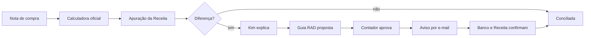

# Conciliação CBS da carteira

> O crédito de CBS da sua empresa, conferido nota por nota.

Projeto da **KingYouBe** no **Hack Brasil 2026**.
Página de apresentação: **https://hackbrasil.kingyoube.com**

## O problema

Com a reforma tributária, toda empresa que compra paga a **CBS** (o novo imposto federal sobre o consumo, que substitui PIS e Cofins) embutida na nota. Esse valor deveria voltar como **crédito**, um desconto no imposto da própria empresa.

Só que, se o fornecedor erra a nota ou não paga a parte dele, o crédito não aparece na conta da Receita. Ninguém avisa. A partir de 2027, a CBS passa a valer dinheiro de verdade, e a Receita entrega a apuração **pronta**: se ninguém conferir a tempo, o saldo dela tende a valer como certo.

Para o escritório de contabilidade, conferir nota por nota contra a Receita, para dezenas de clientes, não fecha a conta de horas.

## A solução

A **Conciliação CBS da carteira** confere cada nota de compra, para todos os clientes do escritório de uma vez, e resolve a diferença com a aprovação do contador:

1. **A nota de compra chega:** as notas de entrada da carteira chegam num lugar só.
2. **A conta é conferida com a calculadora oficial:** o imposto da nota é recalculado com a Calculadora de Tributos que a Receita abriu em código aberto, com memória de cálculo e base legal.
3. **Comparamos com o que a Receita registrou:** débitos e créditos da CBS consultados pelas APIs oficiais da apuração.
4. **A diferença é explicada em português claro:** a Kim, assistente de IA da KingYouBe, explica o motivo. A fila mostra a carteira inteira, ordenada por dinheiro em risco e prazo.
5. **A guia é preparada, o contador aprova e o cliente é avisado:** quando cabe o recolhimento pelo adquirente (RAD), o sistema prepara o DARF (guia oficial). Nada é gerado sem aprovação humana, com trava no servidor. O cliente recebe por e-mail a guia e a data-limite.
6. **O pagamento é provado:** a nota só fica *conciliada* quando o extrato do banco e a Receita confirmam o pagamento.

## O que nos diferencia

- **Carteira inteira numa fila:** o escritório vê todos os clientes numa tela só, e não uma empresa de cada vez.
- **Ação provada:** além de apontar a diferença, prepara a guia, pede o OK e só dá como resolvido quando o pagamento é confirmado.
- **O porquê de cada número:** nota, calculadora oficial e Receita lado a lado, com a explicação em linguagem simples.
- **Sempre atualizado com a Receita:** o sistema acompanha a documentação oficial e avisa quando uma regra ou uma API muda.

## Tecnologia

| Peça | Para quê |
|---|---|
| [Calculadora de Tributos da Receita](https://github.com/ReceitaFederal/calculadora-rtc-regime-regular) (código aberto) | Conferir o imposto de cada nota |
| [APIs da apuração da CBS](https://docs.receitafederal.gov.br/apuracao-cbs/) | Débitos, créditos, pagamentos, recolhimentos e geração do DARF RAD |
| Kim (IA) | Explicar as diferenças. A regra fiscal é fixa e versionada: a IA explica, não decide valor |
| Resend | Avisos por e-mail com rastreio de entrega |
| Firecrawl | Acompanhar mudanças na documentação oficial da Receita |
| Devin | Engenharia assistida por IA, sempre com revisão humana |

## Regras do projeto

- Nenhum DARF é gerado sem aprovação humana registrada, com trava no servidor.
- DARF gerado não é DARF pago: só banco e Receita confirmam.
- Dado de demonstração é sempre fictício e marcado como simulado.
- Senhas e chaves só em cofre: nunca no código, em log ou em conversa.
- Valores em centavos inteiros. CBS não é IBS: o projeto trata só a CBS.

## Como executar

Este repositório está em construção durante o Hack Brasil 2026. Hoje há a **página de apresentação**, no ar em https://hackbrasil.kingyoube.com. O código do ciclo completo (conectores com as APIs da Receita, calculadora oficial, conciliação e tela) entra aqui ao longo do hackathon, e esta seção traz os comandos para rodar a demonstração localmente assim que ela estiver no repositório.

## Status

- [x] Proposta e página de apresentação
- [ ] Conferência com a calculadora oficial
- [ ] Consulta de débitos, créditos, pagamentos e recolhimentos da CBS
- [ ] Conciliação nota × apuração e fila da carteira
- [ ] Guia RAD com aprovação do contador e aviso por e-mail
- [ ] Confirmação do pagamento e nota conciliada
